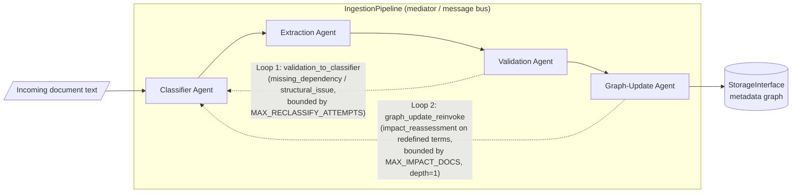

# Multi-Agent Regulatory Document Ingestion (Hackathon, B2 Normativa)

## 1. Problem statement

Financial regulators (SBS) and banks (BCP) continuously publish regulatory
documents -- resolutions, circulars, internal policies, errata, exceptions --
that modify, replace, revoke, consolidate, split, patch or silently redefine
the meaning of prior documents. A naive ingestion pipeline that just chunks
and embeds new text has no way to know that a new resolution **supersedes**
an old one, that a "fe de erratas" **patches** a single clause, or that a
redefinition of "cliente vulnerable" **silently changes how an unrelated,
untouched document should now be interpreted**.

This project (`B2 Normativa`) is a small multi-agent pipeline that reads one
regulatory document at a time, classifies it into one of 9 lifecycle cases,
extracts the structured effects it has on the existing document graph,
validates that those effects are grounded in documents that actually exist,
and finally mutates a metadata graph (status, lineage, patches, flags)
accordingly -- including a **cross-document impact cascade** when a document
redefines a term other active documents rely on.

Because there is no live-demo requirement, the full reasoning trail
(including both feedback loops) is captured as a structured, replayable
**interaction log** (`runs/<run_id>/interaction_log.jsonl`) -- this is the
primary evidence artifact.

## 2. Architecture: 4 agents + 2 feedback loops



The pipeline is the only component that holds references between agents.
Agents never call each other directly -- they return structured values
(`ClassificationResult`, `ExtractionResult`, `ValidationReport`,
`GraphUpdatePlan`, `FeedbackMessage`) and the pipeline routes them. This
keeps every loop bound in one place and gives the log a single writer order.

## 3. Agent roles

| Agent | Module | Role |
|---|---|---|
| **Classifier** | `agents/classifier.py` | Picks one of the 9 `LifecycleCase` values for the incoming document, given the document text and a compact catalog of the existing corpus. Re-invoked with a "RECONSIDER" hint when validation sends feedback, and also answers case-9 impact questions (`assess_impact`) during loop 2. |
| **Extraction** | `agents/extraction.py` | Given the chosen case, extracts the structured `ExtractionResult`: target document ids, effective date, contradiction scope, revocation kind, patches, redefined terms. Also answers `extract_term_usage` during loop 2 (which clauses of a target document actually use the redefined term). |
| **Validation** | `agents/validation.py` | Deterministically resolves every cited reference against storage (`resolve_doc_id` + `check_document_exists`), runs case-specific structural checks (section 3 table of required-target/consolidation/patch/etc. rules), and asks the LLM for a reasoning/feedback-hint. Forces `reclassify` whenever the deterministic checks fail, so the feedback trigger is always reliable. |
| **Graph-Update** | `agents/graph_update.py` | Turns the validated classification into a deterministic list of `GraphOperation`s via the pure function `build_case_operations()` (see section 4 below), applies them to storage, finds other active documents impacted by a redefined term (`find_impact_targets`), and applies the impact ops (`build_impact_operations()`) once each target is reassessed. |

`pipeline.py`'s `IngestionPipeline` is the mediator: it owns the shared
`StorageInterface`, `LLMProvider`, and `InteractionLogger`, instantiates the
4 agents, and drives both feedback loops.

## 4. Metadata schema

All data shapes live in one frozen file, `schema.py`. A stored document
(`StoredDocument`) looks like this (abbreviated, real example from
`sample_docs/seed_corpus.json`):

```json
{
  "metadata": {
    "identity_metadata": {
      "doc_id": "SBS-RES-1000-2020",
      "chunk_index": 0,
      "doc_type": "reglamento",
      "title": "Reglamento de Atencion a Clientes en Condicion de Vulnerabilidad",
      "issuer": "SBS",
      "topic_tags": ["proteccion al consumidor", "conducta de mercado"],
      "defined_terms": ["cliente vulnerable"],
      "referenced_terms": ["cliente vulnerable"],
      "source_uri": "s3://corpus-demo/sbs-res-1000-2020.pdf"
    },
    "lifecycle_metadata": {
      "status": "ACTIVE",
      "valid_from": "2020-03-15",
      "valid_until": null,
      "version": "1.0",
      "review_flags": [],
      "missing_dependencies": [],
      "patch_log": [],
      "notes": []
    },
    "lineage_metadata": {
      "supersedes": [], "superseded_by": [],
      "amends": [], "patched_by": [],
      "consolidates": [], "split_from": [], "split_into": [],
      "contradicts": [],
      "revokes": [], "revoked_by": [],
      "overrides": [], "overridden_by": [],
      "impacts": [],
      "definition_sources": { "cliente vulnerable": "SBS-RES-1000-2020" }
    }
  },
  "raw_text": "ID: SBS-RES-1000-2020\n..."
}
```

## 5. Case -> metadata operations (authoritative table)

Notation: `N` = new document id, `T` = `report.resolved_refs.values()`
(existing, resolvable targets only), `d` = `extraction.effective_date or
N.valid_from or today`. **Every case starts with `create_document(N)`**; the
value is the full `StoredDocument` for N with the "Ops on N" column already
baked into its metadata (lineage rewritten to resolved ids, review flags,
notes, etc.) -- these are *not* separate `GraphOperation`s, since N does not
exist in storage until that op runs. When `report.missing_refs` is
non-empty, N also gets `lifecycle.missing_dependencies = missing_refs` and
the review flag `MISSING_DEPENDENCY`, **for every case**.

| # | Case | Ops baked into N (new) | Ops on each t in T |
|---|---|---|---|
| 1 | NEW_STATEMENT | create only | none |
| 2 | FULL_REPLACEMENT | `supersedes = T` | `set_status SUPERSEDED, valid_until=d`; `append_lineage superseded_by N` |
| 3 | REPLACEMENT_WITH_CONTRADICTION | `supersedes = T`, `contradicts = T`, notes += contradiction_notes, flag `CONTRADICTION` | total: `SUPERSEDED, valid_until=d`; partial: `PARTIALLY_SUPERSEDED` (no valid_until). Both: `superseded_by N`, flag `CONTRADICTED_BY:N` |
| 4 | REVOCATION_OR_EXPIRATION | `revokes = T` | `set_status REVOKED` (revocation) or `EXPIRED` (expiration), `valid_until=d`; `revoked_by N` |
| 5 | CONSOLIDATION | `consolidates = T` | `SUPERSEDED, valid_until=d`; `superseded_by N` |
| 6 | SPLITTING | `split_from = T` | `SUPERSEDED, valid_until=d`; `split_into N`; `superseded_by N` |
| 7 | PATCH_ERRATUM | `amends = T`, doc_type `fe_de_erratas` | status unchanged (ACTIVE); for each patch: `append_patch` (PatchRecord with `patched_by=N`, `effective_date=d`), which also appends `patched_by N` |
| 8 | TEMPORARY_EXCEPTION | `overrides = T`; valid_from/valid_until kept (flag `MISSING_EXPIRY` if no valid_until) | status unchanged (ACTIVE); `overridden_by N`; flag `TEMP_EXCEPTION:N:<from>..<until>` |
| 9 | INDIRECT_DEPENDENCY_UPDATE | `identity.defined_terms += terms`; `definition_sources[term] = N` for each term (applied per-target, see loop 2) | (via loop 2, per affected doc A) `set_definition_source(A, term, N)`; flag `TERM_REDEFINED:<term>:N`; notes set from usage clauses; plus on N: `append_lineage impacts A` |

`build_impact_operations()` emits the case-9 per-affected-doc ops only when
`assessment.affected` is true; otherwise it emits nothing (but the
assessment is still logged).

## 6. The two feedback loops and their bounds

### Loop 1 -- `validation_to_classifier` (bounded reclassification)

```
for attempt in range(MAX_RECLASSIFY_ATTEMPTS + 1):   # default: up to 3 classification passes
    classify -> extract -> validate
    if validation.ok: break
    if attempt == MAX_RECLASSIFY_ATTEMPTS or no progress since last attempt (fixpoint):
        force recommendation = proceed_with_missing_dependency; break
    feedback = validation.build_feedback(...)   # logged as event=feedback, loop=validation_to_classifier
```

Bounds:
1. **Hard cap**: `MAX_RECLASSIFY_ATTEMPTS` extra passes (env `MAX_RECLASSIFY_ATTEMPTS`, default 2 -> 3 classification passes total).
2. **Fixpoint detection**: if the same case comes back with the same missing refs/structural issues, the loop stops early instead of spinning.
3. **Never blocks**: it always terminates with a usable result -- missing references end up recorded as `missing_dependencies` + the `MISSING_DEPENDENCY` flag on the new document, not a pipeline failure.

### Loop 2 -- `graph_update_reinvoke` (bounded cross-document impact cascade, case 9 only)

```
if case == INDIRECT_DEPENDENCY_UPDATE and MAX_CASCADE_DEPTH >= 1:
    requests = find_impact_targets(new_id, redefined_terms, exclude={new_id})  # capped at MAX_IMPACT_DOCS, deduped by target
    for req in requests:
        feedback(graph_update -> classifier, kind=impact_reassessment)   # loop=graph_update_reinvoke
        assess = classifier.assess_impact(req, target_text, target_meta)
        usage  = extraction.extract_term_usage(req, target_text) if assess.affected else None
        feedback(extraction/classifier -> graph_update, kind=impact_result)
        graph_update.apply_impact(req, assess, usage)
```

Bounds:
1. **Depth = 1**: reassessed targets only go through `assess_impact` /
   `extract_term_usage`; they are never re-ingested and never reach
   `find_impact_targets`, so no further cascade can start from them.
   `MAX_CASCADE_DEPTH` documents this bound; depths > 1 are out of scope.
2. **Fan-out cap**: at most `MAX_IMPACT_DOCS` targets per document (default 5).
3. **Dedup**: targets deduped by `target_doc_id` across redefined terms; the new document itself is excluded.
4. **Worst case**: 3 passes x 3 LLM calls (classify/extract/validate) + 1 graph_update + 5 x 2 impact calls = 20 LLM calls per ingested document.

## 7. Agent-interaction log

**Location:** `runs/<run_id>/interaction_log.jsonl` -- one file per CLI
invocation, covering every document in that run in processing order.
Siblings in the same run directory: `summary.json` (the list of
`IngestionResult`) and `storage_snapshot.json` (final metadata state).
Lines are appended and flushed one at a time, so a crashed run still leaves
a usable partial log.

Every line has every key; unused keys are `null`. `event` is one of:
`run_start`, `document_start`, `agent_call`, `agent_result`, `feedback`,
`loop_decision`, `storage_op`, `error`, `document_end`, `run_end`.

```json
{
  "seq": 52,
  "ts": "2026-10-17T17:58:31.416489Z",
  "run_id": "20261017T175831Z-3c022b",
  "source_file": "sample_docs/examples/09_redefinicion_termino.txt",
  "doc_id": "SBS-RES-3003-2024",
  "event": "feedback",
  "agent": "graph_update",
  "from_agent": "graph_update",
  "to_agent": "classifier",
  "loop": "graph_update_reinvoke",
  "iteration": 1,
  "attempt": null,
  "message": "'cliente vulnerable' redefined by SBS-RES-3003-2024; reassess BCP-POL-0050-2022",
  "input": {
    "source_doc_id": "SBS-RES-3003-2024",
    "target_doc_id": "BCP-POL-0050-2022",
    "term": "cliente vulnerable",
    "new_definition": ""
  },
  "output": null,
  "llm": null
}
```

And the loop-1 equivalent, from the same real run (`10_dependencia_faltante.txt`,
which cites the nonexistent `SBS-RES-9999-2010`):

```json
{
  "seq": 80,
  "ts": "2026-10-17T17:58:31.420525Z",
  "source_file": "sample_docs/examples/10_dependencia_faltante.txt",
  "doc_id": "SBS-RES-3004-2024",
  "event": "feedback",
  "agent": "validation",
  "from_agent": "validation",
  "to_agent": "classifier",
  "loop": "validation_to_classifier",
  "iteration": 1,
  "message": "Reconsider classification given missing references: SBS-RES-9999-2010",
  "input": {
    "prior_case": "REVOCATION_OR_EXPIRATION",
    "missing_refs": ["SBS-RES-9999-2010"],
    "structural_issues": [],
    "resolved_refs": {}
  }
}
```

`python main.py trace <log>` renders each line as
`[seq] ts agent  event  message`, adding a `(from -> to, loop=...)` suffix
for `feedback` rows:

```
[52] 2026-10-17T17:58:31.416489Z graph_update feedback      'cliente vulnerable' redefined by SBS-RES-3003-2024; reassess BCP-POL-0050-2022   (graph_update -> classifier, loop=graph_update_reinvoke)
[80] 2026-10-17T17:58:31.420525Z validation   feedback      Reconsider classification given missing references: SBS-RES-9999-2010            (validation -> classifier, loop=validation_to_classifier)
```

Who writes what: `pipeline` writes `run_start`/`document_start`/
`loop_decision`/`document_end`/`run_end` plus loop-2 `feedback`;
`BaseAgent._llm_json` writes `agent_call`/`agent_result`;
`ValidationAgent.build_feedback` (logged by the pipeline via
`logger.feedback`) writes loop-1 `feedback`; `GraphUpdateAgent.apply` /
`apply_impact` write `storage_op`.

## 8. Seams: storage and LLM provider

**Storage (`storage.py`)** -- `StorageInterface` is an ABC with two
implementations, selected by `STORAGE_BACKEND` via `get_storage(settings)`:
- `InMemoryStorage` (`STORAGE_BACKEND=memory`, default) -- a dict-backed
  stand-in: documents live in a `dict[doc_id, StoredDocument]`, chunked with
  the paragraph-greedy `chunk_text()` helper. Needs no external services, so
  the pipeline and smoke test run with nothing to set up.
- `S3DbStorage` (`STORAGE_BACKEND=postgres`) -- the real backend: raw text is
  stored as S3 objects (`get_document_text`/`put_document`, keyed by
  `{S3_PREFIX}{doc_id}.txt`, recorded on `documents.source_uri`), and the
  metadata graph lives in Postgres per `migrations/*.sql` (`documents`,
  `chunks`, `document_lineage`, `document_definition_sources`,
  `document_patches`). `resolve_doc_id` matches on `doc_id`/suffix via SQL;
  `find_active_documents_referencing_term` checks `referenced_terms` then
  falls back to an `ILIKE` scan over `chunks.text`. `psycopg` and `boto3` are
  lazily imported (like the real LLM providers below), so they're only
  required when you actually select this backend -- see `requirements.txt`
  and `.env.example` (`DATABASE_URL`, `S3_BUCKET`, `S3_REGION`,
  `S3_ENDPOINT_URL`, `S3_PREFIX`).

Both leave `apply_operation`/`catalog` as-is (they are already concrete,
storage-agnostic dispatchers on the ABC). No other module needs to change --
`pipeline.py` and the agents only depend on the `StorageInterface` type.

**LLM provider (`llm_provider.py`)** -- `LLMProvider.complete_json(task,
system_prompt, user_prompt, json_schema, context)` is the only seam agents
use. `MockProvider` is a deterministic, keyword/regex-based heuristic
provider (default, `LLM_PROVIDER=mock`) that lets every case and both
feedback loops run with no API key; it prints a warning banner and records
`llm.provider = "mock"` on every logged step so a mock run is never confused
with a real one. To use a real provider, set in `.env` (or pass
`--provider`/`--model`):

```
LLM_PROVIDER=anthropic   # or openai | gemini
LLM_MODEL=<model id>
ANTHROPIC_API_KEY=...    # or OPENAI_API_KEY / GEMINI_API_KEY
```

To add a new provider, implement `LLMProvider` (lazy-import its SDK inside
the class so it's optional), register it in `PROVIDERS`, and append the
"respond with ONLY a JSON object matching this JSON Schema: ..." instruction
to your system prompt -- there is no provider-specific tool-use path.

## 9. Running on your own documents

```bash
pip install -r requirements.txt
cp .env.example .env            # defaults to the mock provider, no API key needed

python main.py ingest path/to/your/docs --seed sample_docs/seed_corpus.json
python main.py trace runs/<run_id>/interaction_log.jsonl
```

- `<path>` can be a single file or a directory. For a directory, files are
  processed in lexicographic order (`*.txt`, `*.md`, then `*.pdf` if
  `pdfplumber` is installed) -- **prefix your filenames** (`01_`, `02_`, ...)
  to control which documents are ingested first, since one shared storage
  is used across the whole run (later documents can reference earlier ones
  from the same run).
- `--seed sample_docs/seed_corpus.json` pre-loads a small existing corpus so
  references like "sustituye a la Resolucion X" or a term redefinition
  actually have something to resolve against. Omit it to start from an
  empty corpus (useful if your own documents only reference each other).
- For a case-9 (redefinition) document to demonstrate anything, make sure
  your seed/corpus has at least one other `ACTIVE` document that already
  uses the term being redefined (in `identity_metadata.referenced_terms` or
  in its raw text) -- otherwise loop 2 correctly finds zero impact targets
  and logs a `loop_decision` saying so, which is also a valid (if less
  interesting) outcome.
- Line 1 of each `.txt`/`.md` file should ideally be `ID: <doc_id>` and the
  text should contain an ISO `YYYY-MM-DD` date -- the `MockProvider`
  heuristics key off both. Real LLM providers do not need this convention.
- Every run writes to a fresh `runs/<run_id>/` directory (never overwritten),
  containing `interaction_log.jsonl`, `summary.json`, and
  `storage_snapshot.json`.

## 9.5. HTTP API (FastAPI)

In addition to the CLI, the same pipeline is exposed over HTTP for
synchronous request/response integration:

```bash
pip install -r requirements.txt
LLM_PROVIDER=mock SEED_PATH=sample_docs/seed_corpus.json uvicorn api:app --reload --port 8000
```

| Method | Path | Purpose |
|---|---|---|
| `GET` | `/health` | Liveness + current provider + document count |
| `POST` | `/ingest` | Ingest one document: `{"source_name": str, "text": str}` -> `IngestResponse` |
| `POST` | `/ingest/batch` | Ingest several documents as one run: `{"documents": [...]}` -> `IngestResponse` |
| `GET` | `/documents` | List the current catalog (`CatalogEntry[]`) |
| `GET` | `/documents/{doc_id}` | Full `DocumentMetadata` for one document (404 if unknown) |
| `GET` | `/runs/{run_id}/log` | The run's `interaction_log.jsonl`, parsed as JSON |
| `GET` | `/runs/{run_id}/summary` | The run's `summary.json` |

`IngestResponse` is `{"run_id": str, "results": IngestionResult[], "has_errors": bool}`
-- `results` is the same `IngestionResult` shape returned by the CLI's table
and `summary.json`; `has_errors` is true if any document in the run has a
non-empty `errors` list, since the HTTP status itself stays 200 even when
individual documents fail (per-document failures are recorded, not raised).
Interactive docs are auto-generated by FastAPI at `/docs` once the server is
running.

Storage is one shared, process-lifetime `StorageInterface` instance, picked by
`STORAGE_BACKEND` the same way as the CLI (`InMemoryStorage` by default,
`S3DbStorage` when `STORAGE_BACKEND=postgres`); `SEED_PATH` preloads it at
startup but only works with the memory backend. A `threading.Lock` serializes
pipeline runs across concurrent requests, since neither backend is guaranteed
thread-safe.

**Out of scope, intentionally:** a producer/consumer (message-queue)
integration -- e.g. an async worker consuming documents off a queue and
calling the same `run_ingest()` helper `api.py` uses internally -- is left as
a `# TODO` in `api.py` and is not planned to be implemented. This API only
supports direct synchronous HTTP request/response communication.

## 10. Known limitations

- **MockProvider is a heuristic, not an LLM.** It is keyword/regex-based
  (see `llm_provider.py`) and is only meant to exercise all 9 cases and both
  feedback loops deterministically and for free. Real classification
  quality depends on the real provider/model you configure.
- **Cascade depth is fixed at 1.** A document whose redefinition impacts
  another document can never trigger a second-order cascade from that
  impacted document; `MAX_CASCADE_DEPTH` exists only to document this, not
  to enable deeper cascades.
- **In-memory storage by default.** `InMemoryStorage` (`STORAGE_BACKEND=memory`)
  does not persist across process runs and is not safe for concurrent
  writers; it exists as a no-setup seam stand-in. Set `STORAGE_BACKEND=postgres`
  (plus `DATABASE_URL`, `S3_BUCKET`) for the persistent `S3DbStorage` backend
  (see section 8) -- note it still serializes all access behind one process's
  lock/connection, so it is not a concurrent-writer solution either.
- **No PDF support without `pdfplumber`.** `.pdf` inputs are skipped with a
  logged error unless `pdfplumber` is installed (it's commented out in
  `requirements.txt` since it isn't needed for the smoke test or `.txt`/`.md`
  ingestion).
- **Reference resolution is best-effort.** `resolve_doc_id` matches an exact
  normalized id or a unique `<number>-<year>` suffix; ambiguous or
  malformed citations become `missing_refs` rather than a hard failure,
  which is by design (see Loop 1) but means a citation that happens to share
  a `<number>-<year>` suffix with the wrong document could resolve
  incorrectly in a larger corpus.
- **No cross-run deduplication.** Each CLI invocation starts from the given
  `--seed` (or empty) and layers the newly ingested documents on top; running
  the same input twice in two separate invocations does not know about the
  first invocation's results unless you pass its `storage_snapshot.json`
  back in as a new seed file.
